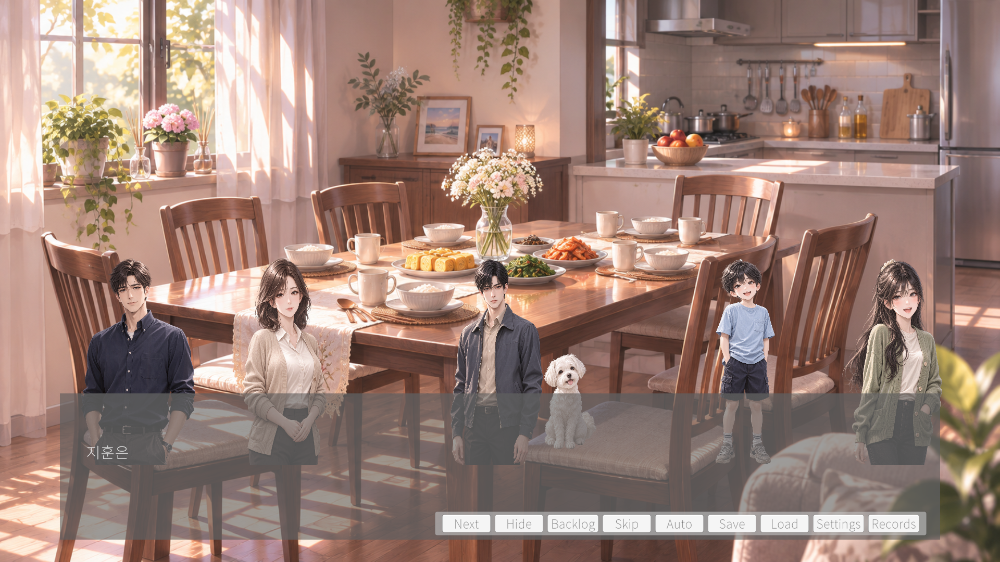
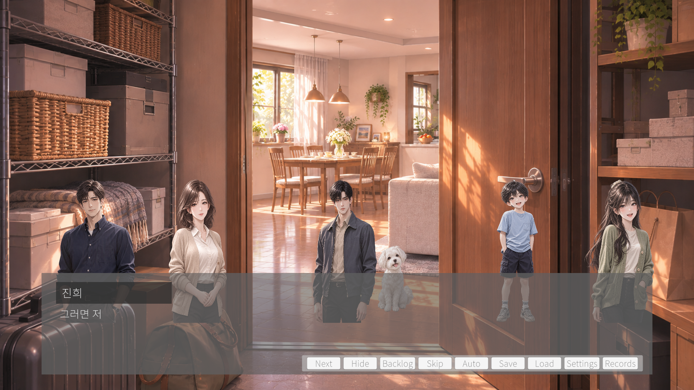
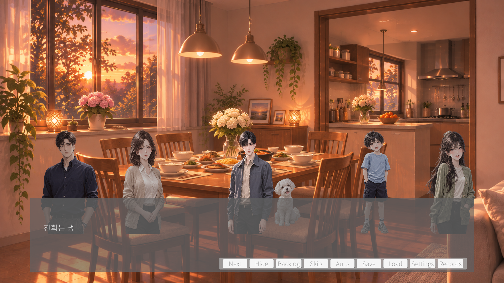
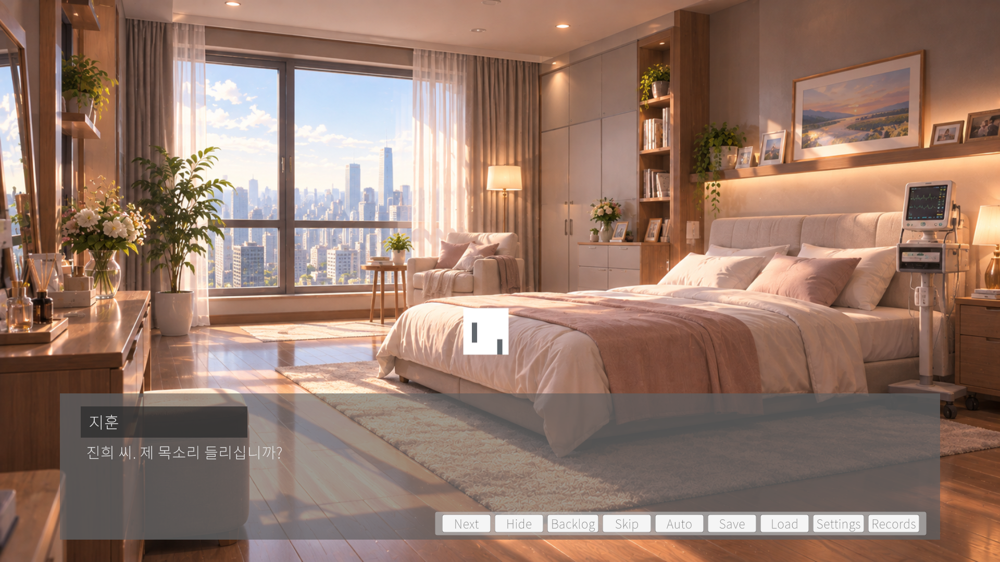

# M10-08 — Final Media Integration Report

**Status: M10-08 IN PROGRESS — SPECIFIC MEDIA GAPS REMAIN.** The supplied candidate media has been imported, assigned, and runtime-checked wherever a suitable source exists. Six frozen IDs still resolve to technical fallbacks; final artistic, rights, and audible-output acceptance is not claimed. This report does not mark M10 complete or the M10-13 user Play Gate passed.

**Historical status note:** This report records the M10-08 media-integration boundary. M10-09 through M10-13 later completed; the user-reported M10-13 prototype gate passed and is recorded in the [M10-13 report](M10_13_USER_PLAY_GATE_REPORT.md). The six fallbacks and per-file provenance gaps remain open; see the current [M10-14 closure report](M10_14_PROLOGUE_MILESTONE_CLOSURE_REPORT.md).

## Baseline and scope

- Base commit: `afc6b02a02da305590453c98e4f27b91471aaa91` (M10-07 / PR #54).
- Branch: `feat/m10-08-production-media-integration`; Unity `6000.3.21f1`.
- Frozen inventory retained: 43 global IDs, 19 scoped expression keys, 103 presentation beats, 379 production paragraphs, 541 explicit compiled Yarn IDs. Canonical source SHA-256 remains `8413E847DD66D7D45585847A935B9C384D91FACFE9724EE27084F3D86FF977E9`.
- Source discovery used Windows known folders: `C:\Users\UserK\Pictures\우만모\프롤로그` (26 PNG) and `C:\Users\UserK\Music\sfx` (12 root WAV + 4 `rain/` WAV = 16).
- Original source files were left in place. There are 36 direct project copies (26 PNG + 10 WAV); the recorded source and imported SHA-256 values match for every direct copy. The finite handoff clip is the one derived project WAV and has separate provenance/hash evidence below.

## Image mappings

| Production ID | Source filename | Imported canonical path | Resolution / visual mapping |
| --- | --- | --- | --- |
| `bg_family_kitchen_morning` | `따스한 아침, 다섯 알의 프라이팬.png` | `Assets/_Project/Art/Backgrounds/bg_family_kitchen_morning.png` | 1672×941px; background |
| `bg_family_table_morning` | `따스한 아침의 가족 식탁.png` | `Assets/_Project/Art/Backgrounds/bg_family_table_morning.png` | 1672×941px; background |
| `bg_family_entrance` | `따뜻한 현대식 아파트 현관 풍경.png` | `Assets/_Project/Art/Backgrounds/bg_family_entrance.png` | 1672×941px; background |
| `bg_family_living_room` | `따뜻한 햇살의 모던 가족 거실.png` | `Assets/_Project/Art/Backgrounds/bg_family_living_room.png` | 1672×941px; background |
| `bg_family_hall` | `따뜻한 햇살이 머무는 우아한 복도.png` | `Assets/_Project/Art/Backgrounds/bg_family_hall.png` | 1672×941px; background |
| `bg_family_storage` | `햇살 가득한 수납실 풍경.png` | `Assets/_Project/Art/Backgrounds/bg_family_storage.png` | 1672×941px; background |
| `bg_family_storage_doorway` | `수납실 너머의 햇살 가득한 식당.png` | `Assets/_Project/Art/Backgrounds/bg_family_storage_doorway.png` | 1672×941px; background |
| `bg_family_table_sunset` | `노을빛 가족 식탁과 아늑한 주방.png` | `Assets/_Project/Art/Backgrounds/bg_family_table_sunset.png` | 1672×941px; background |
| `bg_jinhee_bedroom_day` | `햇살 가득한 도심 속 아늑한 침실.png` | `Assets/_Project/Art/Backgrounds/bg_jinhee_bedroom_day.png` | 1672×941px; background |
| `bg_future_city_street_day` | `햇살 가득한 미래형 카페 거리.png` | `Assets/_Project/Art/Backgrounds/bg_future_city_street_day.png` | 1672×941px; background |
| `bg_dokyung_office` | `현대적인 신경과 상담실 인테리어.png` | `Assets/_Project/Art/Backgrounds/bg_dokyung_office.png` | 1671×941px; background |
| `bg_immersion_preparation` | `첨단 뉴로모듈레이션 치료실.png` | `Assets/_Project/Art/Backgrounds/bg_immersion_preparation.png` | 1671×941px; background |
| `jihun` | `차분한 분위기의 지훈 캐릭터 스프라이트.png` | `Assets/_Project/Art/Characters/jihun/jihun_default.png` | 1122×1402px; character cutout; alpha preserved |
| `jinhee` | `따뜻한 미소의 진희 캐릭터 스프라이트.png` | `Assets/_Project/Art/Characters/jinhee/jinhee_default.png` | 1122×1402px; character cutout; alpha preserved |
| `minseok` | `다정한 미소의 한국인 아버지.png` | `Assets/_Project/Art/Characters/minseok/minseok_default.png` | 1086×1448px; character cutout; alpha preserved |
| `narae` | `미소 짓는 나래의 데일리 룩.png` | `Assets/_Project/Art/Characters/narae/narae_default.png` | 1086×1448px; character cutout; alpha preserved |
| `junho` | `주머니에 손을 넣은 명랑한 소년.png` | `Assets/_Project/Art/Characters/junho/junho_default.png` | 1024×1536px; character cutout; alpha preserved |
| `rope_memory` | `사랑스러운 복슬복슬 강아지_sprite.png` | `Assets/_Project/Art/Characters/rope_memory/rope_memory_default.png` | 1122×1402px; character cutout; alpha preserved |
| `dokyung` | `안경 쓴 전문적인 한국인 의사 초상.png` | `Assets/_Project/Art/Characters/dokyung/dokyung_default.png` | 1086×1448px; character cutout; alpha preserved |
| `eunjung` | `친근한 의료인 은정 초상화.png` | `Assets/_Project/Art/Characters/eunjung/eunjung_default.png` | 1122×1402px; character cutout; alpha preserved |
| `cg_worn_child_shoe` | `햇살 아래 낡은 운동화와 발뒤꿈치.png` | `Assets/_Project/Art/CG/cg_worn_child_shoe.png` | 1672×941px; CG insert |
| `cg_beach_photo_child` | `여름 바다의 행복한 한 장면.png` | `Assets/_Project/Art/CG/cg_beach_photo_child.png` | 1672×941px; CG insert |
| `cg_beach_photo_sea` | `햇살 반짝이는 여름 해변 사진.png` | `Assets/_Project/Art/CG/cg_beach_photo_sea.png` | 1671×941px; CG insert |
| `cg_returned_bag_contents` | `사막빛 속 해변 여행 가방.png` | `Assets/_Project/Art/CG/cg_returned_bag_contents.png` | 1671×941px; CG insert |
| `cg_unused_new_shoe` | `햇살 속 아동화 밑창 클로즈업.png` | `Assets/_Project/Art/CG/cg_unused_new_shoe.png` | 1672×941px; CG insert |
| `cg_present_table_glimpse` | `햇살 가득한 빈 가족 식당 주방.png` | `Assets/_Project/Art/CG/cg_present_table_glimpse.png` | 1671×941px; CG insert |

All PNGs use Unity Sprite / Single import, max texture size 2048, mipmaps off, unreadable runtime texture; character cutouts retain transparency. The candidates were imported under frozen ASCII Production IDs. Direct copy hash equality is recorded in the 43-ID ledger.

## Audio inventory and mapping

| Production ID / disposition | Source file | Source path | Source SHA-256 | Technical format | Project path |
| --- | --- | --- | --- | --- | --- |
| `bgm_ordinary_morning` | `bgm_ordinary_morning.wav` | `C:\Users\UserK\Music\sfx\bgm_ordinary_morning.wav` | `AEB36B8C487C15A6B40CFC78D984B787C5F2AC5C5ECDC16FEC2F36A9257DDC48` | 96.000s, 2ch, 48000Hz, PCM16 | `Assets/_Project/Audio/BGM/bgm_ordinary_morning.wav` |
| `bgm_quiet_farewell` | `bgm_quiet_farewell.wav` | `C:\Users\UserK\Music\sfx\bgm_quiet_farewell.wav` | `DF4EB25F1F669A8BF90A54BE6DEAA3D5354C900B1188F3EC20BCD2194A9200AF` | 193.320s, 2ch, 48000Hz, PCM16 | `Assets/_Project/Audio/BGM/bgm_quiet_farewell.wav` |
| `sfx_frying_oil` | `sfx_frying_oil.wav` | `C:\Users\UserK\Music\sfx\sfx_frying_oil.wav` | `00A562A0A6D859A9C52BE8CD6065F3B62E76181A7D03E8B9751D6FB443F9EF44` | 3.068s, 2ch, 44100Hz, PCM16 | `Assets/_Project/Audio/SFX/sfx_frying_oil.wav` |
| `sfx_home_doorbell` | `sfx_home_doorbell.wav` | `C:\Users\UserK\Music\sfx\sfx_home_doorbell.wav` | `3A52ED4E8A6E0F336825CB2F487B78DFD0F51CC038DC97D770029F3920401AB8` | 4.803s, 2ch, 44100Hz, PCM24 | `Assets/_Project/Audio/SFX/sfx_home_doorbell.wav` |
| `sfx_chair_leg_scrape` | `sfx_chair_leg_scrape.wav` | `C:\Users\UserK\Music\sfx\sfx_chair_leg_scrape.wav` | `4599C23747C804AD6C722C534FA4385B2DA8F9CD39456453AC2A30C447292131` | 2.264s, 2ch, 44100Hz, PCM16 | `Assets/_Project/Audio/SFX/sfx_chair_leg_scrape.wav` |
| `sfx_junho_laugh` | `sfx_junho_laugh.wav` | `C:\Users\UserK\Music\sfx\sfx_junho_laugh.wav` | `64E0FE92F66A95BDD0FD783F5C7516CC86FE1CE78E0244AAAFEB6DEF546E2905` | 0.711s, 2ch, 44100Hz, PCM16 | `Assets/_Project/Audio/SFX/sfx_junho_laugh.wav` |
| `sfx_meal_cutlery` | `sfx_meal_cutlery.wav` | `C:\Users\UserK\Music\sfx\sfx_meal_cutlery.wav` | `F16C073349AAC79E74BDF88488AB69677E6652690E6A266C1544B1E5116F6779` | 1.176s, 2ch, 44100Hz, PCM24 | `Assets/_Project/Audio/SFX/sfx_meal_cutlery.wav` |
| `sfx_low_vibration` | `sfx_low_vibration.wav` | `C:\Users\UserK\Music\sfx\sfx_low_vibration.wav` | `D3BB95E1BE0C827289E0551B0118F78050A763CA65BC9DC8830C4F5B9E3F81B3` | 6.615s, 2ch, 48000Hz, PCM16 | `Assets/_Project/Audio/SFX/sfx_low_vibration.wav` |
| `sfx_equipment_disconnect` | `sfx_equipment_disconnect.wav` | `C:\Users\UserK\Music\sfx\sfx_equipment_disconnect.wav` | `39288128BAD8CA29182D2E20EE7F456EF652219E0D482A7C4CF24B873D8D631B` | 2.760s, 2ch, 48000Hz, PCM16 | `Assets/_Project/Audio/SFX/sfx_equipment_disconnect.wav` |
| `sfx_old_bus_brake` | `sfx_old_bus_brake.wav` | `C:\Users\UserK\Music\sfx\sfx_old_bus_brake.wav` | `A625691A78D94D786164CC53EB88E5165C97900AA23C781E15072976874C8748` | 13.378s, 2ch, 44100Hz, PCM16 | `Assets/_Project/Audio/SFX/sfx_old_bus_brake.wav` |
| `sfx_connection_rain_handoff` (derived) | `sfx_equipment_disconnect_alt.wav` + `rain/mixkit-light-rain-loop-2393.wav` | `C:\Users\UserK\Music\sfx\sfx_equipment_disconnect_alt.wav`<br>`C:\Users\UserK\Music\sfx\rain\mixkit-light-rain-loop-2393.wav` | `CF9BBE5C402F9E9941371CC2C06864EDF11F71C01FABC746EE6E9AE399E79109`<br>`0E90FA5F678CCA6966E66477B75B8FE608BF845D54E4B3E3EFFF839B9CC6805E` | 4.250s, 2ch, 48000Hz, PCM16 | `Assets/_Project/Audio/SFX/sfx_connection_rain_handoff.wav` |
| Unmatched/component | `sfx_raindrop_awning.wav` | `C:\Users\UserK\Music\sfx\sfx_raindrop_awning.wav` | `BEC1E7FCCD19134667E57A7A3750156B98F9FBAE9F58BBC729EDF482B503279E` | 12.714s, 2ch, 44100Hz, PCM16 | Rejected for this ID: 12.714s full clip; waveform correlation 0.9999955 with the rain-splashing source; not a discrete awning drop. |
| Unmatched/component | `sfx_equipment_disconnect_alt.wav` | `C:\Users\UserK\Music\sfx\sfx_equipment_disconnect_alt.wav` | `CF9BBE5C402F9E9941371CC2C06864EDF11F71C01FABC746EE6E9AE399E79109` | 2.760s, 2ch, 48000Hz, PCM16 | Derived component only; alternate take is not mapped as the frozen equipment-disconnect ID. |
| Unmatched/component | `mixkit-heavy-rain-and-thunder-in-background-2406.wav` | `C:\Users\UserK\Music\sfx\rain\mixkit-heavy-rain-and-thunder-in-background-2406.wav` | `53A97D572465A0E0AD7C0A181D2772485243DF76CB5B6F06DB618A4C2C7764E9` | 22.267s, 2ch, 44100Hz, PCM16 | Unassigned raw source; too broad for a discrete authored cue. |
| Unmatched/component | `mixkit-heavy-rain-drops-2399.wav` | `C:\Users\UserK\Music\sfx\rain\mixkit-heavy-rain-drops-2399.wav` | `4917056D6E09B32045CFC1207047A84C524265A33B0D5D8970D1FE59A47260C0` | 12.174s, 2ch, 44100Hz, PCM16 | Unassigned raw source; heavy rain is not the isolated awning drop. |
| Unmatched/component | `mixkit-rain-splashing-1264.wav` | `C:\Users\UserK\Music\sfx\rain\mixkit-rain-splashing-1264.wav` | `1CCF84DED841D308DEAF0701E36354327756780C4AD38BCDD88D8DFB8A87F076` | 12.714s, 2ch, 44100Hz, PCM24 | Unassigned raw source; matches the 12.714s awning candidate closely and is not a discrete drop. |
| Unmatched/component | `mixkit-light-rain-loop-2393.wav` | `C:\Users\UserK\Music\sfx\rain\mixkit-light-rain-loop-2393.wav` | `0E90FA5F678CCA6966E66477B75B8FE608BF845D54E4B3E3EFFF839B9CC6805E` | 15.000s, 2ch, 44100Hz, PCM16 | Used only as a 2.5s component of the finite handoff composite; not a looping ambient subsystem. |

BGM import is Streaming / Vorbis quality 0.9, loop enabled, catalog gain 0.25, stereo, preloaded. Short SFX use DecompressOnLoad, preserve stereo, and preload. No human acoustic audition was available; runtime AudioSource activity and logical catalog IDs are observed, but audible level/tone/mix remain UNVERIFIED.

The derived `sfx_connection_rain_handoff.wav` is a 4.250s finite stereo PCM16/48kHz one-shot. Processing: `sfx_equipment_disconnect_alt.wav` at 0.40 gain; 2.5s excerpt of light rain starting 8.4s at 0.80 gain; rain resampled from 44.1kHz to 48kHz; equal-power crossfade beginning at 1.75s; 10ms composite edge fade-in and 0.5s finite tail fade; no normalization/limiter. Its SHA-256 is `6B490645878EBEC335686A334A869382F60ED58EF562108059E0699A70D6BD52`. Mixkit-labeled source rights remain unverified.

## Complete 43-ID reconciliation

`INTEGRATED` means the catalog/definition now points to the candidate project media and Unity importer tests passed; it does not mean rights or artistic sign-off. All evidence is from the actual Unity project. For character rows the Catalog reference points through the retained character definition asset.

| Production ID | Source filename | Source full path | Source SHA-256 | Imported path | Imported SHA-256 | Category | Resolution / duration | Import status | Catalog reference | Temporary or final | Game View / audio verification | Provenance status | Outstanding issue |
| --- | --- | --- | --- | --- | --- | --- | --- | --- | --- | --- | --- | --- | --- |
| bg_family_kitchen_morning | 따스한 아침, 다섯 알의 프라이팬.png | C:\Users\UserK\Pictures\우만모\프롤로그\따스한 아침, 다섯 알의 프라이팬.png | 28886554E7110644A0F03CF2DFEFB24188AD0F1E6FE99214D09607B8E4014E5B | Assets/_Project/Art/Backgrounds/bg_family_kitchen_morning.png | 28886554E7110644A0F03CF2DFEFB24188AD0F1E6FE99214D09607B8E4014E5B | BG | 1672×941px | Sprite/Single; max 2048; mipmaps off; opaque artwork | M10_ProductionPresentationCatalog.backgrounds/bg_family_kitchen_morning | User-created candidate; final art/provenance acceptance pending | Game View screenshot captured on background change; runtime ID observed. | User-supplied; creator claim recorded; per-file rights/release evidence not present | Game View confirms five eggs; pan-first kitchen and wide room are compositionally compatible. |
| bg_family_table_morning | 따스한 아침의 가족 식탁.png | C:\Users\UserK\Pictures\우만모\프롤로그\따스한 아침의 가족 식탁.png | 3D014E37666D1D66AE21C0B65AE08884E4A9A83CAF4FC1368843C3E8A9FDA1FF | Assets/_Project/Art/Backgrounds/bg_family_table_morning.png | 3D014E37666D1D66AE21C0B65AE08884E4A9A83CAF4FC1368843C3E8A9FDA1FF | BG | 1672×941px | Sprite/Single; max 2048; mipmaps off; opaque artwork | M10_ProductionPresentationCatalog.backgrounds/bg_family_table_morning | User-created candidate; final art/provenance acceptance pending | Game View screenshot captured on background change; runtime ID observed. | User-supplied; creator claim recorded; per-file rights/release evidence not present | All five humans plus ordinary Rope are staged as six foreground sprites after arrival; the supplied BG itself is an unoccupied dining room, so no people are duplicated in the plate. |
| bg_family_entrance | 따뜻한 현대식 아파트 현관 풍경.png | C:\Users\UserK\Pictures\우만모\프롤로그\따뜻한 현대식 아파트 현관 풍경.png | E43C3795A40C77E1D3CFE4F698D9C1A7CF0604790267A1F93C7540FD99A258D6 | Assets/_Project/Art/Backgrounds/bg_family_entrance.png | E43C3795A40C77E1D3CFE4F698D9C1A7CF0604790267A1F93C7540FD99A258D6 | BG | 1672×941px | Sprite/Single; max 2048; mipmaps off; opaque artwork | M10_ProductionPresentationCatalog.backgrounds/bg_family_entrance | User-created candidate; final art/provenance acceptance pending | Game View screenshot captured on background change; runtime ID observed. | User-supplied; creator claim recorded; per-file rights/release evidence not present |  |
| bg_family_living_room | 따뜻한 햇살의 모던 가족 거실.png | C:\Users\UserK\Pictures\우만모\프롤로그\따뜻한 햇살의 모던 가족 거실.png | 74D0738DBB6A2AE98F247D77E7AF59378C0086FFE80B141B6D30E6ED55903B6A | Assets/_Project/Art/Backgrounds/bg_family_living_room.png | 74D0738DBB6A2AE98F247D77E7AF59378C0086FFE80B141B6D30E6ED55903B6A | BG | 1672×941px | Sprite/Single; max 2048; mipmaps off; opaque artwork | M10_ProductionPresentationCatalog.backgrounds/bg_family_living_room | User-created candidate; final art/provenance acceptance pending | Game View screenshot captured on background change; runtime ID observed. | User-supplied; creator claim recorded; per-file rights/release evidence not present |  |
| bg_family_hall | 따뜻한 햇살이 머무는 우아한 복도.png | C:\Users\UserK\Pictures\우만모\프롤로그\따뜻한 햇살이 머무는 우아한 복도.png | B8EA70AF69F062EDB9D124305C8A85B223BBF9EF276EAFB2DF2A8E2C5112EBBA | Assets/_Project/Art/Backgrounds/bg_family_hall.png | B8EA70AF69F062EDB9D124305C8A85B223BBF9EF276EAFB2DF2A8E2C5112EBBA | BG | 1672×941px | Sprite/Single; max 2048; mipmaps off; opaque artwork | M10_ProductionPresentationCatalog.backgrounds/bg_family_hall | User-created candidate; final art/provenance acceptance pending | Game View screenshot captured on background change; runtime ID observed. | User-supplied; creator claim recorded; per-file rights/release evidence not present |  |
| bg_family_storage | 햇살 가득한 수납실 풍경.png | C:\Users\UserK\Pictures\우만모\프롤로그\햇살 가득한 수납실 풍경.png | C04AE32FB697B0BC42FD4A0C6AF030B3F8EA79E317CE6EC9611A52BF1198308D | Assets/_Project/Art/Backgrounds/bg_family_storage.png | C04AE32FB697B0BC42FD4A0C6AF030B3F8EA79E317CE6EC9611A52BF1198308D | BG | 1672×941px | Sprite/Single; max 2048; mipmaps off; opaque artwork | M10_ProductionPresentationCatalog.backgrounds/bg_family_storage | User-created candidate; final art/provenance acceptance pending | Game View screenshot captured on background change; runtime ID observed. | User-supplied; creator claim recorded; per-file rights/release evidence not present |  |
| bg_family_storage_doorway | 수납실 너머의 햇살 가득한 식당.png | C:\Users\UserK\Pictures\우만모\프롤로그\수납실 너머의 햇살 가득한 식당.png | E0BBDB125A13F04153DBA35DB036B9D657206088689657301BDFFFBBFDC17FEE | Assets/_Project/Art/Backgrounds/bg_family_storage_doorway.png | E0BBDB125A13F04153DBA35DB036B9D657206088689657301BDFFFBBFDC17FEE | BG | 1672×941px | Sprite/Single; max 2048; mipmaps off; opaque artwork | M10_ProductionPresentationCatalog.backgrounds/bg_family_storage_doorway | User-created candidate; final art/provenance acceptance pending | Game View screenshot captured on background change; runtime ID observed. | User-supplied; creator claim recorded; per-file rights/release evidence not present |  |
| bg_family_table_sunset | 노을빛 가족 식탁과 아늑한 주방.png | C:\Users\UserK\Pictures\우만모\프롤로그\노을빛 가족 식탁과 아늑한 주방.png | 38ECA2E51CC3FF58CB5E36435B3F577AD7066665B429C04C5B3AA337258DD269 | Assets/_Project/Art/Backgrounds/bg_family_table_sunset.png | 38ECA2E51CC3FF58CB5E36435B3F577AD7066665B429C04C5B3AA337258DD269 | BG | 1672×941px | Sprite/Single; max 2048; mipmaps off; opaque artwork | M10_ProductionPresentationCatalog.backgrounds/bg_family_table_sunset | User-created candidate; final art/provenance acceptance pending | Game View screenshot captured on background change; runtime ID observed. | User-supplied; creator claim recorded; per-file rights/release evidence not present |  |
| bg_jinhee_bedroom_day | 햇살 가득한 도심 속 아늑한 침실.png | C:\Users\UserK\Pictures\우만모\프롤로그\햇살 가득한 도심 속 아늑한 침실.png | 3C56152B3760B82D3467658F6EBFE36EF7CCBB3B9CABF9DF35D894ED0040D2EF | Assets/_Project/Art/Backgrounds/bg_jinhee_bedroom_day.png | 3C56152B3760B82D3467658F6EBFE36EF7CCBB3B9CABF9DF35D894ED0040D2EF | BG | 1672×941px | Sprite/Single; max 2048; mipmaps off; opaque artwork | M10_ProductionPresentationCatalog.backgrounds/bg_jinhee_bedroom_day | User-created candidate; final art/provenance acceptance pending | Game View screenshot captured on background change; runtime ID observed. | User-supplied; creator claim recorded; per-file rights/release evidence not present |  |
| bg_future_city_street_day | 햇살 가득한 미래형 카페 거리.png | C:\Users\UserK\Pictures\우만모\프롤로그\햇살 가득한 미래형 카페 거리.png | 3C0F3F0B9088DF845336D29322F2873C62E03C32DD46B786B986F5A173D552C3 | Assets/_Project/Art/Backgrounds/bg_future_city_street_day.png | 3C0F3F0B9088DF845336D29322F2873C62E03C32DD46B786B986F5A173D552C3 | BG | 1672×941px | Sprite/Single; max 2048; mipmaps off; opaque artwork | M10_ProductionPresentationCatalog.backgrounds/bg_future_city_street_day | User-created candidate; final art/provenance acceptance pending | Game View screenshot captured on background change; runtime ID observed. | User-supplied; creator claim recorded; per-file rights/release evidence not present |  |
| bg_dokyung_office | 현대적인 신경과 상담실 인테리어.png | C:\Users\UserK\Pictures\우만모\프롤로그\현대적인 신경과 상담실 인테리어.png | 3F1B272812F0727569F538E97391927A320031C6E30B1294A7A8BF5B5676477E | Assets/_Project/Art/Backgrounds/bg_dokyung_office.png | 3F1B272812F0727569F538E97391927A320031C6E30B1294A7A8BF5B5676477E | BG | 1671×941px | Sprite/Single; max 2048; mipmaps off; opaque artwork | M10_ProductionPresentationCatalog.backgrounds/bg_dokyung_office | User-created candidate; final art/provenance acceptance pending | Game View screenshot captured on background change; runtime ID observed. | User-supplied; creator claim recorded; per-file rights/release evidence not present |  |
| bg_immersion_preparation | 첨단 뉴로모듈레이션 치료실.png | C:\Users\UserK\Pictures\우만모\프롤로그\첨단 뉴로모듈레이션 치료실.png | 002A289FD4A8AAB374746A30421C158BCAEDECC8009AF65A86A73D819D090B0B | Assets/_Project/Art/Backgrounds/bg_immersion_preparation.png | 002A289FD4A8AAB374746A30421C158BCAEDECC8009AF65A86A73D819D090B0B | BG | 1671×941px | Sprite/Single; max 2048; mipmaps off; opaque artwork | M10_ProductionPresentationCatalog.backgrounds/bg_immersion_preparation | User-created candidate; final art/provenance acceptance pending | Game View screenshot captured on background change; runtime ID observed. | User-supplied; creator claim recorded; per-file rights/release evidence not present |  |
| jihun | 차분한 분위기의 지훈 캐릭터 스프라이트.png | C:\Users\UserK\Pictures\우만모\프롤로그\차분한 분위기의 지훈 캐릭터 스프라이트.png | D40AB91C1919403E9F1F1E4DFFCD8DD711D5EA284950649BCA8ABDBD6E069715 | Assets/_Project/Art/Characters/jihun/jihun_default.png | D40AB91C1919403E9F1F1E4DFFCD8DD711D5EA284950649BCA8ABDBD6E069715 | Character | 1122×1402px | Sprite/Single; max 2048; mipmaps off; alpha preserved | M10_ProductionPresentationCatalog.characterDefinitions → M10_jihun.asset | User-created candidate; final art/provenance acceptance pending | Body Sprite visible in Play; scoped expressions use neutral fallback. | User-supplied; creator claim recorded; per-file rights/release evidence not present | Scoped keys: default, uneasy; all headSprite references remain null. |
| jinhee | 따뜻한 미소의 진희 캐릭터 스프라이트.png | C:\Users\UserK\Pictures\우만모\프롤로그\따뜻한 미소의 진희 캐릭터 스프라이트.png | C353B8782B3AA75683D8D139337B24ECAF0C548AEAE0B6391EF66D1D6B93BE48 | Assets/_Project/Art/Characters/jinhee/jinhee_default.png | C353B8782B3AA75683D8D139337B24ECAF0C548AEAE0B6391EF66D1D6B93BE48 | Character | 1122×1402px | Sprite/Single; max 2048; mipmaps off; alpha preserved | M10_ProductionPresentationCatalog.characterDefinitions → M10_jinhee.asset | User-created candidate; final art/provenance acceptance pending | Body Sprite visible in Play; scoped expressions use neutral fallback. | User-supplied; creator claim recorded; per-file rights/release evidence not present | Scoped keys: default, smile, uneasy, crying, firm; all headSprite references remain null. |
| minseok | 다정한 미소의 한국인 아버지.png | C:\Users\UserK\Pictures\우만모\프롤로그\다정한 미소의 한국인 아버지.png | ED32C5062BD8CC1D3CD6EE6A9895D526AD2015DC2858016A8C7DD2F6A7CEFD1C | Assets/_Project/Art/Characters/minseok/minseok_default.png | ED32C5062BD8CC1D3CD6EE6A9895D526AD2015DC2858016A8C7DD2F6A7CEFD1C | Character | 1086×1448px | Sprite/Single; max 2048; mipmaps off; alpha preserved | M10_ProductionPresentationCatalog.characterDefinitions → M10_minseok.asset | User-created candidate; final art/provenance acceptance pending | Body Sprite visible in Play; scoped expressions use neutral fallback. | User-supplied; creator claim recorded; per-file rights/release evidence not present | Scoped keys: default, quiet; all headSprite references remain null. |
| narae | 미소 짓는 나래의 데일리 룩.png | C:\Users\UserK\Pictures\우만모\프롤로그\미소 짓는 나래의 데일리 룩.png | 3D58F01BEDC983318D5E2394F453A1DCD0CFBC0FD62F7A4C85843BFECD1BAD87 | Assets/_Project/Art/Characters/narae/narae_default.png | 3D58F01BEDC983318D5E2394F453A1DCD0CFBC0FD62F7A4C85843BFECD1BAD87 | Character | 1086×1448px | Sprite/Single; max 2048; mipmaps off; alpha preserved | M10_ProductionPresentationCatalog.characterDefinitions → M10_narae.asset | User-created candidate; final art/provenance acceptance pending | Body Sprite visible in Play; scoped expressions use neutral fallback. | User-supplied; creator claim recorded; per-file rights/release evidence not present | Scoped keys: default; all headSprite references remain null. |
| junho | 주머니에 손을 넣은 명랑한 소년.png | C:\Users\UserK\Pictures\우만모\프롤로그\주머니에 손을 넣은 명랑한 소년.png | 37ADA3863763FEEBC098E112F3C70A41C6A46BD65D161E3DAAE3B03B2037213F | Assets/_Project/Art/Characters/junho/junho_default.png | 37ADA3863763FEEBC098E112F3C70A41C6A46BD65D161E3DAAE3B03B2037213F | Character | 1024×1536px | Sprite/Single; max 2048; mipmaps off; alpha preserved | M10_ProductionPresentationCatalog.characterDefinitions → M10_junho.asset | User-created candidate; final art/provenance acceptance pending | Body Sprite visible in Play; scoped expressions use neutral fallback. | User-supplied; creator claim recorded; per-file rights/release evidence not present | Scoped keys: default, pout, eager; all headSprite references remain null. |
| rope_memory | 사랑스러운 복슬복슬 강아지_sprite.png | C:\Users\UserK\Pictures\우만모\프롤로그\사랑스러운 복슬복슬 강아지_sprite.png | 5029AB704B3D79EE8B0E9BF227824E3AF88E67683836B1F24F0C559514C7E10A | Assets/_Project/Art/Characters/rope_memory/rope_memory_default.png | 5029AB704B3D79EE8B0E9BF227824E3AF88E67683836B1F24F0C559514C7E10A | Character | 1122×1402px | Sprite/Single; max 2048; mipmaps off; alpha preserved | M10_ProductionPresentationCatalog.characterDefinitions → M10_rope_memory.asset | User-created candidate; final art/provenance acceptance pending | Body Sprite visible in Play; scoped expressions use neutral fallback. | User-supplied; creator claim recorded; per-file rights/release evidence not present | Scoped keys: default, alert; all headSprite references remain null. |
| dokyung | 안경 쓴 전문적인 한국인 의사 초상.png | C:\Users\UserK\Pictures\우만모\프롤로그\안경 쓴 전문적인 한국인 의사 초상.png | 778AFD4498BB95BB4A0D3F88F0294B4BC5C0F76464DE7AF413F40685A124EE9F | Assets/_Project/Art/Characters/dokyung/dokyung_default.png | 778AFD4498BB95BB4A0D3F88F0294B4BC5C0F76464DE7AF413F40685A124EE9F | Character | 1086×1448px | Sprite/Single; max 2048; mipmaps off; alpha preserved | M10_ProductionPresentationCatalog.characterDefinitions → M10_dokyung.asset | User-created candidate; final art/provenance acceptance pending | Body Sprite visible in Play; scoped expressions use neutral fallback. | User-supplied; creator claim recorded; per-file rights/release evidence not present | Scoped keys: default; all headSprite references remain null. |
| eunjung | 친근한 의료인 은정 초상화.png | C:\Users\UserK\Pictures\우만모\프롤로그\친근한 의료인 은정 초상화.png | EDED6F8D3B8D27D2DE1C0A7980D78AEA8DB4A25807972DDDB8944E59F9D6AC62 | Assets/_Project/Art/Characters/eunjung/eunjung_default.png | EDED6F8D3B8D27D2DE1C0A7980D78AEA8DB4A25807972DDDB8944E59F9D6AC62 | Character | 1122×1402px | Sprite/Single; max 2048; mipmaps off; alpha preserved | M10_ProductionPresentationCatalog.characterDefinitions → M10_eunjung.asset | User-created candidate; final art/provenance acceptance pending | Body Sprite visible in Play; scoped expressions use neutral fallback. | User-supplied; creator claim recorded; per-file rights/release evidence not present | Scoped keys: default; all headSprite references remain null. |
| cg_worn_child_shoe | 햇살 아래 낡은 운동화와 발뒤꿈치.png | C:\Users\UserK\Pictures\우만모\프롤로그\햇살 아래 낡은 운동화와 발뒤꿈치.png | 2E2013844FE963BDC9CAE445E3DCEAFA3B567844983FDA25992EBEA58E361A92 | Assets/_Project/Art/CG/cg_worn_child_shoe.png | 2E2013844FE963BDC9CAE445E3DCEAFA3B567844983FDA25992EBEA58E361A92 | CG | 1672×941px | Sprite/Single; max 2048; mipmaps off; opaque artwork | M10_ProductionPresentationCatalog.cgs/cg_worn_child_shoe | User-created candidate; final art/provenance acceptance pending | CG ID observed at authored cue in Play; user framing review remains. | User-supplied; creator claim recorded; per-file rights/release evidence not present |  |
| cg_beach_photo_child | 여름 바다의 행복한 한 장면.png | C:\Users\UserK\Pictures\우만모\프롤로그\여름 바다의 행복한 한 장면.png | ED852FEE3F35DE6F85CCAE5D9BEDB3D48BE731AC8599D3FD2C970DA02DFA95C7 | Assets/_Project/Art/CG/cg_beach_photo_child.png | ED852FEE3F35DE6F85CCAE5D9BEDB3D48BE731AC8599D3FD2C970DA02DFA95C7 | CG | 1672×941px | Sprite/Single; max 2048; mipmaps off; opaque artwork | M10_ProductionPresentationCatalog.cgs/cg_beach_photo_child | User-created candidate; final art/provenance acceptance pending | CG ID observed at authored cue in Play; user framing review remains. | User-supplied; creator claim recorded; per-file rights/release evidence not present |  |
| cg_beach_photo_sea | 햇살 반짝이는 여름 해변 사진.png | C:\Users\UserK\Pictures\우만모\프롤로그\햇살 반짝이는 여름 해변 사진.png | B146BA0F5D8A8B7BD64F6B489FDAF5E7EE28908E91B25E6C0E1BAFB8102141CF | Assets/_Project/Art/CG/cg_beach_photo_sea.png | B146BA0F5D8A8B7BD64F6B489FDAF5E7EE28908E91B25E6C0E1BAFB8102141CF | CG | 1671×941px | Sprite/Single; max 2048; mipmaps off; opaque artwork | M10_ProductionPresentationCatalog.cgs/cg_beach_photo_sea | User-created candidate; final art/provenance acceptance pending | CG ID observed at authored cue in Play; user framing review remains. | User-supplied; creator claim recorded; per-file rights/release evidence not present |  |
| cg_returned_bag_contents | 사막빛 속 해변 여행 가방.png | C:\Users\UserK\Pictures\우만모\프롤로그\사막빛 속 해변 여행 가방.png | 742B7A2783976C512CE619EDA5A8D4E3F5D8F397D42380AF32CD233940AE8DB2 | Assets/_Project/Art/CG/cg_returned_bag_contents.png | 742B7A2783976C512CE619EDA5A8D4E3F5D8F397D42380AF32CD233940AE8DB2 | CG | 1671×941px | Sprite/Single; max 2048; mipmaps off; opaque artwork | M10_ProductionPresentationCatalog.cgs/cg_returned_bag_contents | User-created candidate; final art/provenance acceptance pending | CG ID observed at authored cue in Play; user framing review remains. | User-supplied; creator claim recorded; per-file rights/release evidence not present | Open travel bag/towel/bottle are visible; specific snack-wrapper detail should receive user art review. |
| cg_unused_new_shoe | 햇살 속 아동화 밑창 클로즈업.png | C:\Users\UserK\Pictures\우만모\프롤로그\햇살 속 아동화 밑창 클로즈업.png | 33ADBD4015E6E058473B9889157B9E94AD61EB68F714FE09D943ABEB56E1A281 | Assets/_Project/Art/CG/cg_unused_new_shoe.png | 33ADBD4015E6E058473B9889157B9E94AD61EB68F714FE09D943ABEB56E1A281 | CG | 1672×941px | Sprite/Single; max 2048; mipmaps off; opaque artwork | M10_ProductionPresentationCatalog.cgs/cg_unused_new_shoe | User-created candidate; final art/provenance acceptance pending | CG ID observed at authored cue in Play; user framing review remains. | User-supplied; creator claim recorded; per-file rights/release evidence not present |  |
| cg_present_table_glimpse | 햇살 가득한 빈 가족 식당 주방.png | C:\Users\UserK\Pictures\우만모\프롤로그\햇살 가득한 빈 가족 식당 주방.png | 1BBB6E48A0DC6E41F7E887514822B438319B3401000DC7196B5B8E2AF4DBBA90 | Assets/_Project/Art/CG/cg_present_table_glimpse.png | 1BBB6E48A0DC6E41F7E887514822B438319B3401000DC7196B5B8E2AF4DBBA90 | CG | 1671×941px | Sprite/Single; max 2048; mipmaps off; opaque artwork | M10_ProductionPresentationCatalog.cgs/cg_present_table_glimpse | User-created candidate; final art/provenance acceptance pending | CG ID observed at authored cue in Play; user framing review remains. | User-supplied; creator claim recorded; per-file rights/release evidence not present | Empty domestic dining room/table, wide angle differs from exact same-camera brief; only a 1s insert, no isolated empty-chair close-up. Keep provisional for user semantic review. |
| rope | — | — | — | Assets/_Project/Art/TemporaryM10/TEMPORARY_cyber_dog_marker.png | 5C7120029DCC5327F35DC9A7B146F02C67AB40EE3046F8CA6C0AD0816870EAA0 | Character | 128×64px | Temporary Sprite marker; not final cyber-dog art | M10_ProductionPresentationCatalog.characterDefinitions → M10_rope.asset | TEMPORARY | Runtime identity/reveal node observed; temporary marker visible after S006 L924. | User-supplied; creator claim recorded; per-file rights/release evidence not present | No distinct cyber-dog production PNG; ordinary dog stays scoped as rope_memory.; Scoped keys: default, alert; all headSprite references remain null. |
| bgm_ordinary_morning | bgm_ordinary_morning.wav | C:\Users\UserK\Music\sfx\bgm_ordinary_morning.wav | AEB36B8C487C15A6B40CFC78D984B787C5F2AC5C5ECDC16FEC2F36A9257DDC48 | Assets/_Project/Audio/BGM/bgm_ordinary_morning.wav | AEB36B8C487C15A6B40CFC78D984B787C5F2AC5C5ECDC16FEC2F36A9257DDC48 | BGM | 96.000s, 2ch, 48000Hz, PCM16 | Streaming/Vorbis q=0.9, loop, 0.25 catalog gain | M10_ProductionAudioCatalog.bgm/bgm_ordinary_morning | User-created candidate; final art/provenance acceptance pending | Logical ID and AudioSource playback state observed in Play; audible output/mix UNVERIFIED. | User-supplied; creator claim recorded; per-file rights/release evidence not present |  |
| bgm_quiet_farewell | bgm_quiet_farewell.wav | C:\Users\UserK\Music\sfx\bgm_quiet_farewell.wav | DF4EB25F1F669A8BF90A54BE6DEAA3D5354C900B1188F3EC20BCD2194A9200AF | Assets/_Project/Audio/BGM/bgm_quiet_farewell.wav | DF4EB25F1F669A8BF90A54BE6DEAA3D5354C900B1188F3EC20BCD2194A9200AF | BGM | 193.320s, 2ch, 48000Hz, PCM16 | Streaming/Vorbis q=0.9, loop, 0.25 catalog gain | M10_ProductionAudioCatalog.bgm/bgm_quiet_farewell | User-created candidate; final art/provenance acceptance pending | Logical ID and AudioSource playback state observed in Play; audible output/mix UNVERIFIED. | User-supplied; creator claim recorded; per-file rights/release evidence not present |  |
| sfx_frying_oil | sfx_frying_oil.wav | C:\Users\UserK\Music\sfx\sfx_frying_oil.wav | 00A562A0A6D859A9C52BE8CD6065F3B62E76181A7D03E8B9751D6FB443F9EF44 | Assets/_Project/Audio/SFX/sfx_frying_oil.wav | 00A562A0A6D859A9C52BE8CD6065F3B62E76181A7D03E8B9751D6FB443F9EF44 | SFX | 3.068s, 2ch, 44100Hz, PCM16 | DecompressOnLoad; stereo preserved; preloaded | M10_ProductionAudioCatalog.sfx/sfx_frying_oil | User-created candidate; final art/provenance acceptance pending | Logical ID and AudioSource playback state observed in Play; audible output/mix UNVERIFIED. | User-supplied; creator claim recorded; per-file rights/release evidence not present |  |
| sfx_plate_counter | — | — | — | Assets/_Project/Audio/TEMPORARY_M10_Silence.wav | 3FA20276D8A4131431490ED129D0B05FAFA4E9C82D4339B5CF635512103D6615 | SFX | silent fallback | Temporary silent WAV | M10_ProductionAudioCatalog.sfx/sfx_plate_counter | TEMPORARY | Catalog resolves to silent fallback; no production playback. | User-supplied; creator claim recorded; per-file rights/release evidence not present | No confidently matching source in the complete 16-WAV inventory. |
| sfx_home_doorbell | sfx_home_doorbell.wav | C:\Users\UserK\Music\sfx\sfx_home_doorbell.wav | 3A52ED4E8A6E0F336825CB2F487B78DFD0F51CC038DC97D770029F3920401AB8 | Assets/_Project/Audio/SFX/sfx_home_doorbell.wav | 3A52ED4E8A6E0F336825CB2F487B78DFD0F51CC038DC97D770029F3920401AB8 | SFX | 4.803s, 2ch, 44100Hz, PCM24 | DecompressOnLoad; stereo preserved; preloaded | M10_ProductionAudioCatalog.sfx/sfx_home_doorbell | User-created candidate; final art/provenance acceptance pending | Logical ID and AudioSource playback state observed in Play; audible output/mix UNVERIFIED. | User-supplied; creator claim recorded; per-file rights/release evidence not present |  |
| sfx_child_entry_steps | — | — | — | Assets/_Project/Audio/TEMPORARY_M10_Silence.wav | 3FA20276D8A4131431490ED129D0B05FAFA4E9C82D4339B5CF635512103D6615 | SFX | silent fallback | Temporary silent WAV | M10_ProductionAudioCatalog.sfx/sfx_child_entry_steps | TEMPORARY | Catalog resolves to silent fallback; no production playback. | User-supplied; creator claim recorded; per-file rights/release evidence not present | No confidently matching source in the complete 16-WAV inventory. |
| sfx_chair_leg_scrape | sfx_chair_leg_scrape.wav | C:\Users\UserK\Music\sfx\sfx_chair_leg_scrape.wav | 4599C23747C804AD6C722C534FA4385B2DA8F9CD39456453AC2A30C447292131 | Assets/_Project/Audio/SFX/sfx_chair_leg_scrape.wav | 4599C23747C804AD6C722C534FA4385B2DA8F9CD39456453AC2A30C447292131 | SFX | 2.264s, 2ch, 44100Hz, PCM16 | DecompressOnLoad; stereo preserved; preloaded | M10_ProductionAudioCatalog.sfx/sfx_chair_leg_scrape | User-created candidate; final art/provenance acceptance pending | Logical ID and AudioSource playback state observed in Play; audible output/mix UNVERIFIED. | User-supplied; creator claim recorded; per-file rights/release evidence not present |  |
| sfx_junho_laugh | sfx_junho_laugh.wav | C:\Users\UserK\Music\sfx\sfx_junho_laugh.wav | 64E0FE92F66A95BDD0FD783F5C7516CC86FE1CE78E0244AAAFEB6DEF546E2905 | Assets/_Project/Audio/SFX/sfx_junho_laugh.wav | 64E0FE92F66A95BDD0FD783F5C7516CC86FE1CE78E0244AAAFEB6DEF546E2905 | SFX | 0.711s, 2ch, 44100Hz, PCM16 | DecompressOnLoad; stereo preserved; preloaded | M10_ProductionAudioCatalog.sfx/sfx_junho_laugh | User-created candidate; final art/provenance acceptance pending | Logical ID and AudioSource playback state observed in Play; audible output/mix UNVERIFIED. | User-supplied; creator claim recorded; per-file rights/release evidence not present |  |
| sfx_meal_cutlery | sfx_meal_cutlery.wav | C:\Users\UserK\Music\sfx\sfx_meal_cutlery.wav | F16C073349AAC79E74BDF88488AB69677E6652690E6A266C1544B1E5116F6779 | Assets/_Project/Audio/SFX/sfx_meal_cutlery.wav | F16C073349AAC79E74BDF88488AB69677E6652690E6A266C1544B1E5116F6779 | SFX | 1.176s, 2ch, 44100Hz, PCM24 | DecompressOnLoad; stereo preserved; preloaded | M10_ProductionAudioCatalog.sfx/sfx_meal_cutlery | User-created candidate; final art/provenance acceptance pending | Logical ID and AudioSource playback state observed in Play; audible output/mix UNVERIFIED. | User-supplied; creator claim recorded; per-file rights/release evidence not present |  |
| sfx_sink_washing | — | — | — | Assets/_Project/Audio/TEMPORARY_M10_Silence.wav | 3FA20276D8A4131431490ED129D0B05FAFA4E9C82D4339B5CF635512103D6615 | SFX | silent fallback | Temporary silent WAV | M10_ProductionAudioCatalog.sfx/sfx_sink_washing | TEMPORARY | Catalog resolves to silent fallback; no production playback. | User-supplied; creator claim recorded; per-file rights/release evidence not present | No confidently matching source in the complete 16-WAV inventory. |
| sfx_slipper_toe_tap | — | — | — | Assets/_Project/Audio/TEMPORARY_M10_Silence.wav | 3FA20276D8A4131431490ED129D0B05FAFA4E9C82D4339B5CF635512103D6615 | SFX | silent fallback | Temporary silent WAV | M10_ProductionAudioCatalog.sfx/sfx_slipper_toe_tap | TEMPORARY | Catalog resolves to silent fallback; no production playback. | User-supplied; creator claim recorded; per-file rights/release evidence not present | No confidently matching source in the complete 16-WAV inventory. |
| sfx_low_vibration | sfx_low_vibration.wav | C:\Users\UserK\Music\sfx\sfx_low_vibration.wav | D3BB95E1BE0C827289E0551B0118F78050A763CA65BC9DC8830C4F5B9E3F81B3 | Assets/_Project/Audio/SFX/sfx_low_vibration.wav | D3BB95E1BE0C827289E0551B0118F78050A763CA65BC9DC8830C4F5B9E3F81B3 | SFX | 6.615s, 2ch, 48000Hz, PCM16 | DecompressOnLoad; stereo preserved; preloaded | M10_ProductionAudioCatalog.sfx/sfx_low_vibration | User-created candidate; final art/provenance acceptance pending | Logical ID and AudioSource playback state observed in Play; audible output/mix UNVERIFIED. | User-supplied; creator claim recorded; per-file rights/release evidence not present |  |
| sfx_equipment_disconnect | sfx_equipment_disconnect.wav | C:\Users\UserK\Music\sfx\sfx_equipment_disconnect.wav | 39288128BAD8CA29182D2E20EE7F456EF652219E0D482A7C4CF24B873D8D631B | Assets/_Project/Audio/SFX/sfx_equipment_disconnect.wav | 39288128BAD8CA29182D2E20EE7F456EF652219E0D482A7C4CF24B873D8D631B | SFX | 2.760s, 2ch, 48000Hz, PCM16 | DecompressOnLoad; stereo preserved; preloaded | M10_ProductionAudioCatalog.sfx/sfx_equipment_disconnect | User-created candidate; final art/provenance acceptance pending | Logical ID and AudioSource playback state observed in Play; audible output/mix UNVERIFIED. | User-supplied; creator claim recorded; per-file rights/release evidence not present |  |
| sfx_connection_rain_handoff | sfx_equipment_disconnect_alt.wav + rain/mixkit-light-rain-loop-2393.wav | C:\Users\UserK\Music\sfx\sfx_equipment_disconnect_alt.wav; C:\Users\UserK\Music\sfx\rain\mixkit-light-rain-loop-2393.wav | CF9BBE5C402F9E9941371CC2C06864EDF11F71C01FABC746EE6E9AE399E79109; 0E90FA5F678CCA6966E66477B75B8FE608BF845D54E4B3E3EFFF839B9CC6805E | Assets/_Project/Audio/SFX/sfx_connection_rain_handoff.wav | 6B490645878EBEC335686A334A869382F60ED58EF562108059E0699A70D6BD52 | SFX | 4.250s, 2ch, 48000Hz, PCM16 | Finite derived stereo PCM16/48kHz; DecompressOnLoad | M10_ProductionAudioCatalog.sfx/sfx_connection_rain_handoff | Derived user-supplied/Mixkit-labeled candidate; source usage rights and audible acceptance pending | Logical SFX ID and SFX AudioSource activity observed in Play; audible handoff UNVERIFIED. | User-supplied component + Mixkit-labeled rain; rights not verified | Human audition and Mixkit source usage-right evidence are unverified. |
| sfx_raindrop_awning | sfx_raindrop_awning.wav | C:\Users\UserK\Music\sfx\sfx_raindrop_awning.wav | BEC1E7FCCD19134667E57A7A3750156B98F9FBAE9F58BBC729EDF482B503279E | Assets/_Project/Audio/TEMPORARY_M10_Silence.wav | 3FA20276D8A4131431490ED129D0B05FAFA4E9C82D4339B5CF635512103D6615 | SFX | silent fallback | Temporary silent WAV | M10_ProductionAudioCatalog.sfx/sfx_raindrop_awning | TEMPORARY | Catalog resolves to silent fallback; no production playback. | User-supplied; creator claim recorded; per-file rights/release evidence not present | 12.714s source is a near-duplicate of Mixkit rain-splashing (r=0.9999955); no isolated awning drop. |
| sfx_old_bus_brake | sfx_old_bus_brake.wav | C:\Users\UserK\Music\sfx\sfx_old_bus_brake.wav | A625691A78D94D786164CC53EB88E5165C97900AA23C781E15072976874C8748 | Assets/_Project/Audio/SFX/sfx_old_bus_brake.wav | A625691A78D94D786164CC53EB88E5165C97900AA23C781E15072976874C8748 | SFX | 13.378s, 2ch, 44100Hz, PCM16 | DecompressOnLoad; stereo preserved; preloaded | M10_ProductionAudioCatalog.sfx/sfx_old_bus_brake | User-created candidate; final art/provenance acceptance pending | Logical ID and AudioSource playback state observed in Play; audible output/mix UNVERIFIED. | User-supplied; creator claim recorded; per-file rights/release evidence not present |  |

### The 19 character-scoped expression keys

| Character | Frozen expression keys | Actual supplied visual coverage |
| --- | --- | --- |
| `jihun` | `jihun/default`, `jihun/uneasy` | Default body only; every scoped `headSprite` is null and falls back to that body; no separate expression art. |
| `jinhee` | `jinhee/default`, `jinhee/smile`, `jinhee/uneasy`, `jinhee/crying`, `jinhee/firm` | Default body only; every scoped `headSprite` is null and falls back to that body; no separate expression art. |
| `minseok` | `minseok/default`, `minseok/quiet` | Default body only; every scoped `headSprite` is null and falls back to that body; no separate expression art. |
| `narae` | `narae/default` | Default body only; every scoped `headSprite` is null and falls back to that body; no separate expression art. |
| `junho` | `junho/default`, `junho/pout`, `junho/eager` | Default body only; every scoped `headSprite` is null and falls back to that body; no separate expression art. |
| `rope_memory` | `rope_memory/default`, `rope_memory/alert` | Default body only; every scoped `headSprite` is null and falls back to that body; no separate expression art. |
| `rope` | `rope/default`, `rope/alert` | Default body only; every scoped `headSprite` is null and falls back to that body; no separate expression art. |
| `dokyung` | `dokyung/default` | Default body only; every scoped `headSprite` is null and falls back to that body; no separate expression art. |
| `eunjung` | `eunjung/default` | Default body only; every scoped `headSprite` is null and falls back to that body; no separate expression art. |

Fifteen scoped keys pre-existed. The implementation restored four missing entries without creating global IDs. All 19 are retained; facial progression is still technically neutral, including Jinhee smile/uneasy/crying/firm.

## Presentation and audio observations

- All 12 backgrounds, eight default human/ordinary-dog cutouts, and six CG IDs are wired to canonical production assets; all 26 source PNGs remain byte-identical copies. The five eggs are discernible in the actual pan image and in its Game View capture.
- The morning table, storage doorway and sunset table stage all five humans plus ordinary Rope as six foreground sprites. The Game View captures show the complete group, with Rope beside Jihun. The source BGs themselves are unoccupied plates. The present-table CG is only called for one second; its unoccupied wide table reads as a setting, but its camera differs from the brief and remains a user review point.
- Character cutouts have alpha and preserve body identity; the regular dog is `rope_memory`. `rope` remains a distinct temporary mechanical marker; it does not use the ordinary dog image.
- Scene composition correction: added a sixth fixed `outer_far_right` slot to Production and Replay; saved both six-slot views through Unity Editor APIs. Production anchors are `.12, .27, .48, .56, .73, .88`; Replay uses `.14, .284, .48, .56, .716, .86`. S001/S005 table and doorway staging uses the six slots. Ordinary Rope has a per-character `(0, -125)` anchored stage offset, preserving each visual root baseline and placing the dog beside Jihun without covering his leg. The serialized DialogueRunner start node remains `M2_UI_START`; controlled Play run stops that smoke node after startup and enters `PROLOGUE_S001_START`.
- BGM IDs observed in the run: `bgm_ordinary_morning`, then `bgm_quiet_farewell`; the latter fades/stops at authored S006. Catalog defaults are 0.25 each. No audible output can be confirmed from the Editor automation. S002’s proposed steady lowering remains an M10-04/artistic decision and was not implemented.
- SFX AudioSource activity was observed at authored cues; the missing plate-counter, child-entry, sink-washing, slipper-toe-tap and discrete awning-drop IDs remain silent fallback. No acoustic audition, clipping judgment, or relative-to-dialogue level approval is claimed. The finite equipment→rain composite is catalog-integrated without creating an Ambient subsystem.
- S006 localized white-door effect and S007 medical diagram were visible during the continuous Play run. S008 profile inspection order included first-review thoughts for Sunju/Haejin, no immediate Hana thought, and Continue. The driver’s final review flags are cleared when the browser closes; Continue was gated on all three reviews being complete.
- The existing Korean TextMesh Pro font renders the authored Korean text in Game View. Its original font/release provenance remains unverified; this task does not add another font or claim font clearance.

### Captured actual Game View evidence

The saved screenshots below are direct captures from the continuous VN_Main Play run after the final staging correction. The six sprites are foreground characters; the source background plates contain no painted family members.







A separate targeted Play probe at `PROLOGUE_S006_P07` shows the distinct `rope` identity using its current mechanical marker. It documents the unresolved art gap; it is not final cyber-dog artwork.



## Validation

- Focused: `M10_08ProductionMediaTests` — 7 passed in the full run. Coverage: all 43 frozen IDs, canonical imported Sprite/AudioClip references and importer settings, aliases, all 19 neutral-fallback expressions, six-person scene/Yarn staging and safe restaging order, Rope offset, and line-ID preservation.
- Full unfiltered EditMode suite: **493 passed, 0 failed, 0 skipped** (13.9 seconds).
- Final Play Console delta from cursor 708: **0 new errors, 0 new warnings**. Post-run Editor ground truth: 0 errors, 1 existing nonblocking warning, compilationFailed=false. The warning was already present at the fresh pre-Play baseline.
- Continuous Unity Play: S001–S008 completed from `PROLOGUE_S001_START`; 380 line presentations / 379 unique authored line IDs; end title visible; no driver failure. All 12 backgrounds and six CG IDs were observed; both BGM IDs and SFX playback activity were observed; manual hold, localized door effect, diagram, profile branch and Continue were exercised. The six-person morning/doorway/sunset compositions were inspected from Game View screenshots.
- The continuous driver’s accumulated visible-character set includes `rope` after its S006 reveal; the catalog identity remains distinct from `rope_memory`. The observed sprite is the distinct `TEMPORARY_cyber_dog_marker`, so this verifies reveal wiring only, not final cyber-dog art.

### Final Play result

```text
startNode=PROLOGUE_S001_START
runnerStopped=True
titleVisible=True
linesConsumed=380;uniqueLineIds=379;backlog=379;readHistory=384
inputClicks=389;profileOrder=inspect=1,review-thought profile=1 line=line:prologue_s008_010,back=1,inspect=1,back=1,inspect=2,back=2,inspect=0,review-thought profile=0 line=line:prologue_s008_009,back=0,continue
profilesReviewed=False,False,False;allReviewed=False;continueClicked=True
backgrounds=bg_family_kitchen_morning,bg_family_entrance,bg_family_table_morning,bg_family_living_room,bg_family_hall,bg_family_storage,bg_family_storage_doorway,bg_family_table_sunset,bg_jinhee_bedroom_day,bg_future_city_street_day,bg_dokyung_office,bg_immersion_preparation
cgs=cg_worn_child_shoe,cg_beach_photo_child,cg_beach_photo_sea,cg_returned_bag_contents,cg_unused_new_shoe,cg_present_table_glimpse
visibleCharacters=dokyung,eunjung,jihun,jinhee,junho,minseok,narae,rope,rope_memory;cyberDogVisible=True
bgmIds=bgm_ordinary_morning,bgm_quiet_farewell;lastBgm=;bgmSourcePlayingAtEnd=False
sfxSourceActiveObserved=True;sfxStartEdgesObserved=8
manualHoldLineSeen=True;manualHoldLines=1
localizedDoorEffectSeen=True;medicalDiagramSeen=True
screenshotPaths=C:\Users\UserK\AppData\Local\Temp\M10_08_background_bg_family_kitchen_morning.png;C:\Users\UserK\AppData\Local\Temp\M10_08_background_bg_family_entrance.png;C:\Users\UserK\AppData\Local\Temp\M10_08_background_bg_family_table_morning.png;C:\Users\UserK\AppData\Local\Temp\M10_08_background_bg_family_living_room.png;C:\Users\UserK\AppData\Local\Temp\M10_08_background_bg_family_hall.png;C:\Users\UserK\AppData\Local\Temp\M10_08_background_bg_family_living_room.png;C:\Users\UserK\AppData\Local\Temp\M10_08_background_bg_family_hall.png;C:\Users\UserK\AppData\Local\Temp\M10_08_background_bg_family_storage.png;C:\Users\UserK\AppData\Local\Temp\M10_08_background_bg_family_storage_doorway.png;C:\Users\UserK\AppData\Local\Temp\M10_08_background_bg_family_table_sunset.png;C:\Users\UserK\AppData\Local\Temp\M10_08_background_bg_family_entrance.png;C:\Users\UserK\AppData\Local\Temp\M10_08_localized_door_effect.png;C:\Users\UserK\AppData\Local\Temp\M10_08_background_bg_jinhee_bedroom_day.png;C:\Users\UserK\AppData\Local\Temp\M10_08_background_bg_future_city_street_day.png;C:\Users\UserK\AppData\Local\Temp\M10_08_background_bg_dokyung_office.png;C:\Users\UserK\AppData\Local\Temp\M10_08_medical_diagram.png;C:\Users\UserK\AppData\Local\Temp\M10_08_background_bg_immersion_preparation.png;C:\Users\UserK\AppData\Local\Temp\M10_08_profile_overview.png;C:\Users\UserK\AppData\Local\Temp\M10_08_profile_detail_1.png;C:\Users\UserK\AppData\Local\Temp\M10_08_profile_detail_2.png;C:\Users\UserK\AppData\Local\Temp\M10_08_profile_detail_0.png
elapsedSeconds=107.6
failure=none
```

The finite status names are intentional: the Play driver exercises EventSystem-validated pointer-click dispatch against the real Unity `Button` objects and the Yarn line presenter. It logs actual runtime catalog IDs and screenshots; it cannot certify human-audible sound or replace final artistic review.

## Outstanding production requirements and M10-09 handoff

- Six IDs remain temporary: `rope` cyber-dog; `sfx_plate_counter`; `sfx_child_entry_steps`; `sfx_sink_washing`; `sfx_slipper_toe_tap`; `sfx_raindrop_awning`. Supply distinct, semantically correct resources; keep the frozen IDs.
- Supply expressive head artwork for scoped expression keys, especially Jinhee’s authored emotional progression; do not add new global identities.
- Confirm creator/service/license/release evidence for user-supplied art/audio and Mixkit-labeled rain source; record source provenance before external release. Confirm Korean font provenance separately.
- User review still needed for the present-table camera match, CG bag contents, character/body styling, S002 morning-BGM level continuity, SFX/BGM audibility, levels and timing. No automatic M10-13 user Play Gate pass is claimed.
- M10-09 should continue with production save-file round-trip/checkpoint acceptance, re-entry/transient media behavior, remaining M10-08 resource closure, provenance, and a user-led art/audio review. This report does not begin M10-09 automatically.

## Source preservation and repository hygiene

All 26 original PNGs and all 16 original WAVs remain in their user folders. Direct project copies were verified SHA-256-identical to their source. The only derived WAV is listed with both source hashes and exact processing. No original source folder, unused alternate take, Unity cache, or temporary harness is intended for the commit.
